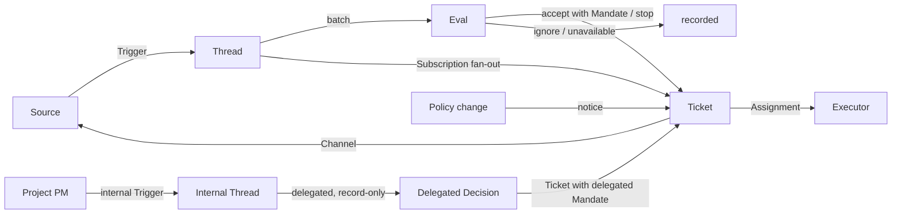

# 001 Domain model

This document names the concepts of dsh-superagent and the rules each one keeps. The code, the tools the agents call, the panel and the other documents use these terms and no others. Following [000 Philosophy](000-philosophy.md), the model holds only concepts the work needs, and a business need becomes an attribute of one of them.

## Flow

Work moves from Trigger to Eval to execution. A Source produces Triggers. A Trigger fans out as context to the Tickets subscribed to its Threads. A person's message that reached a Ticket this way stays with that Ticket; every other Trigger enters Eval, which decides whether it asks for new work. When Eval accepts, it creates a Ticket with a Mandate. An Assignment hands the Ticket to an Executor, and results go back to the Source through a Channel.

## Concepts

Source, Thread, Eval, Mandate and Subscription form the core domain; the rest supports them.

| Concept | Definition | Rules it keeps | Why it exists |
| --- | --- | --- | --- |
| Source | A stream of events. A Source kind is a reusable implementation; a Source instance is one configuration of a kind: whether it runs and what it listens to | Holds its read position and its own bot identity. Defines what counts as an event, including conditions that only hold over time. Drops the bot's own messages and Triggers outside what it listens to before they enter the domain. Translates each Trigger into the Threads it belongs to and the Channel addresses to reply on | A restart must not replay events |
| Trigger | One immutable event with the Source's own metadata, such as its actor | Belongs to one or more Threads. Accepting a Trigger twice creates one Ticket | The unit of audit and of idempotence |
| Thread | Triggers in time order; the Source defines which Triggers form one Thread | At most one Eval runs on it at a time. It may have several Tickets. It holds its Subscriptions, the running Eval and its Decision history | Gives Eval a consistent view and its context |
| Correlation | The relation between Threads that one Trigger belongs to | Adds context; never routes | Lets Eval follow related evidence |
| Channel | The write side of a Thread; the Source defines its addresses | A Thread may have several Channels; a Ticket holds a set of them | Acknowledgements, replies, pull requests and resolved reviews are all writes |
| Policy | The versioned assessment rules and each Source's part: who may originate work through that Source, in that Source's own identities, how the list is synchronized, and which bots may make candidates | The Policy version covers the rules, the accept mode and the Source parts. A change that bears on a live Ticket, such as a change to a rule it was accepted under, is delivered to its Assignment; it does not revoke Mandates. Identities on different Sources are never mapped to each other | When the rules change, a running Eval must be discarded |
| Eval | The judgement on a batch of Triggers, in two layers: gate and assessment | Input: the Trigger batch, a Thread snapshot, every Ticket on the Thread including ended ones, and the current Policy. Output: a Decision. Holds no state | Decides whether new work starts, goes on or stops |
| Mandate | What an accept grants: the Policy version, the scope, the strength, the matched rules, the sender's identity on that Source and how the Source received the Trigger, and optionally the Worker tools it allows | Immutable; wider scope means a new Ticket. A Ticket's end does not end it: only a person's stop withdraws it, and a Policy that no longer holds it revokes it. Revalidated against the current Policy before an ended Ticket resumes. A `delegated` Mandate is revalidated by its Project PM Mandate, not by an external allowed list. `allowTools` only narrows the Executor's work tools, never the filesystem or permissions; absent means every work tool | States why the work may be done, how far it may go, and which Worker tools it may use |
| Ticket | A unit of authorized work | An Eval creates one on the external path; a Project's PM creates one inside its Project through a `delegated`, record-only Eval. Refers to its Mandate; holds its Channels and Inputs. Goes open → ended, and back to open when a person's message on one of its Threads resumes it, unless a person stopped it. A Project Ticket also carries `archived` while its Project is archived: it is neither open nor executable, and unarchiving the Project clears the marker without ending or resuming it. Defines its own state instead of following the Executor's. Its `projectId` is empty while the Router owns it directly; a PM-created Ticket carries its Project's id | Owns the execution and its reports |
| Project | A goal the Router delegates to one PM Session for ongoing management | Created from one Trigger by a `project` Decision with a real Eval id, through a gate-only Eval that creates no Ticket. Holds its Project Profile, its goal, the PM Mandate, the PM's latest report and the Tickets its PM created. Status is `active`, `paused`, `ended` or `archived`: only an active Project creates Tickets; a paused Project also creates no new Assignment (`pauseMode` soft lets running Assignments finish, hard ends pending/running Assignments with `projectPaused`); ending stops every still-open child Ticket with the ordinary Ticket stop semantics and keeps its history; archiving stores the previous `archivedFrom` status, marks every child Ticket archived and ends its running Assignments with `projectArchived`, while unarchiving restores `archivedFrom` and clears those Ticket markers without restarting work. It may hold `pendingNotes`, including notes from a child Worker Session archived/restored in DSH or recovery from a hard pause, which the PM reads once with its next prompt. The PM is a small Router inside the Project: it creates 1–5 Project Tickets per call and starts no other work | Keeps a longer goal separate from one unit of Ticket work |
| Assignment | The binding of a Ticket to one Executor instance | A Ticket has several over time. Goes pending → running → ended independently of the Ticket. Only its final report may end the Ticket on the Executor's side | The Executor is outside the domain, but who executes must be inside it |
| Subscription | A many-to-many relation between Tickets and Threads, held by the Thread | A matching Trigger fans out to every live subscribed Ticket, with no check of who sent it; a person's message that reaches a Ticket this way takes no Eval. A Thread an Executor follows for context reaches its Ticket the same way, but lends it no authority and does not resume it. An ended Ticket keeps its Subscriptions, including that of a pull request that closed or merged: a person's message resumes it under the same Mandate, with no Eval or Decision; messages from bots and CI do not reach it, since its Executor reads its Threads again when it resumes. A Ticket a person stopped receives nothing. The main Session attaches a Thread to an existing Ticket only when its message points at that Ticket explicitly. A person can drop every Subscription on a Thread; an Executor can drop only its own Ticket's Subscription to a Thread it finds unrelated, except the Thread its Ticket started on and a Thread a Source made it follow, such as its pull request's | Later discussion reaches the Executor without anyone mentioning the agent again |

A person is not a domain concept. A Trigger carries its actor's identifier as the Source gives it. An allowed list is a Source's part of the Policy, in that Source's identities. That one person has accounts on several Sources is prompt text that the agents read when they need it.

The Executor, with its Sessions and directories, is outside the domain and connects through Assignments.

Aggregates: a Source holds its read position. A Thread holds its Subscriptions, its running Eval, which runs serially and merges Triggers that arrive meanwhile into the next batch, and its Decision history. A Ticket holds its Assignments, Channels and Inputs, and refers to Decisions by id.

A Project is created by a Decision of kind `project`, which names its `projectId` and no `ticketId`; the Eval that produces it never asks the assessor. Its `PMMandate` has the shape of a Mandate but delegates project-level management to `pm-<projectId>`, names the Project's goal and uses that goal as its scope; the Decision records the same PM Mandate for audit. The PM creates Tickets for the Project through an internal Source: each task records an internal Trigger whose actor is the PM Session, a record-only Eval with a real eval id and a `delegated` basis, and a `delegated` Decision that names the Ticket and the Project; the Ticket's Mandate carries the PM Mandate's strength, Policy version and actor, its own scope and the delegated basis. A task may also name `allow_tools`, which the Ticket Mandate records as `allowTools`: it may only narrow the PM Mandate's list and otherwise leaves the worker with every work tool. A Ticket so created carries the Project's `projectId`, no Channel, and only the external Threads its task names as Subscriptions; it never inherits the Project's source Thread.

A native DSH archive of `pm-<projectId>` archives the whole Project in the application; a native archive of `worker-<ticketId>` ends only that Ticket's current Assignment (`sessionArchived`), leaves the Ticket open, and queues one `workerArchived` note for the PM without waking it. Unarchiving the worker changes neither Ticket nor Assignment and queues an optional `workerRestored` note; unarchiving the PM restores the Project's `archivedFrom`. A low-frequency reconcile against the host's archived Session ids keeps these states, and therefore the notes, convergent.

A paused Project has a `pauseMode`. Soft pause lets running Assignments finish and asks the PM to report and stop; hard pause immediately ends pending/running Assignments with `projectPaused`, stops the PM and child Worker Sessions without ending or archiving Tickets, and leaves the state paused. All new Assignments (creation, retry, resume, attach) are refused with `projectPaused` until resume. Resuming restores `active`, clears the mode, does not restart old Assignments, and after a hard pause queues a `resumedFromHard` note telling the PM to re-read the Project and Tickets and synchronize before continuing.

A PM may send one of its child Tickets a coordination message. The message becomes a `note` Ticket Input in that Ticket's history, so it is context and grants no authority, no new tools and no new Mandate. A running Assignment receives it as an Input; a pending Assignment is started; with `wake` a retryable Ticket may get a new Assignment, but `wake` never bypasses a paused/archived/ended Project, and a Ticket whose worker Session is archived only queues the note without claiming delivery.

## Rejected concepts

| Rejected | Reason |
| --- | --- |
| Principal or Membership as an entity, or mapping identities across Sources | A person is Trigger metadata; an allowed list is a Source's part of the Policy; a cross-Source mapping is prompt text |
| Eval scheduling its own delayed Triggers | A condition that needs waiting is an ordinary Source, so Eval never depends back on Sources |
| Waiting or revoked Eval states | Waiting belongs to Sources; an Eval that runs out of time queues its Triggers again, or ends `unavailable` |
| At most one live Ticket per Thread | One Thread can carry several independent pieces of work; the assessment avoids duplicates from the Ticket list |
| An "append to Ticket" Decision | Appending is Subscription fan-out and needs no Eval |
| Admission checks on Subscriptions | A Subscription covers the whole Thread; the Mandate separates authorization from context |
| Correlation that routes | Subscriptions route; Correlation only adds context |
| Ticket state that follows the DSH Session | A Ticket can be handed off, resumed, or run by several Executors, so it defines its own state |
| An Executor declaring that a person asked it to stop | Only Eval decides the strength of an end |
| Cancelling running Tickets on a Policy change | A cancelled change leaves half-finished work; the change is recorded and delivered instead |
| Locking all of an Executor Session's tools when it fails or blocks | It would refuse a person working directly in the Session, and the report after recovery; pausing automatic input is enough |
| Inferring "waiting on a person" from a report's free text | The classification needs structured facts; the Executor asks through a structured field |

## What is reusable

The concepts above and their rules are reusable. The Source implementations, the Policy contents, the Executor and the Channel implementations belong to a deployment. Each Source keeps its own words internally, such as message, chat or notification, and translates them into Triggers.

| Part | In this repository |
| --- | --- |
| Source | Feishu: live events, history recovery, polling of subscribed topics. GitHub: notifications, subscribed Issues and pull requests, CI changes, pull requests merged or closed, and, where switched on, every new Issue, pull request and comment in the repository and the default branch's CI |
| Policy | Assessment rules, and each Source's allowed list, its sync, its bot list and its admission table |
| Executor | A DSH Executor Session and a directory per Ticket, in an execution environment whose variables the Executor and the Sources register |
| Channel | Feishu topic replies, GitHub comments and review thread replies |

## Glossary

A reference list of the terms this and the later documents use, with their Chinese names; the later documents explain the terms not introduced above. The panel shows one language at a time; its (?) button opens this glossary with both languages. The messages agents send to people on GitHub and Feishu use plain language, not these terms.

| Term | 中文 | Meaning |
| --- | --- | --- |
| Agent | 智能体 | The automated team member dsh-superagent runs, acting on Sources through identities such as a GitHub account and a Feishu bot |
| Main Session | 主 Session | The DSH Session that evaluates Triggers, accepts and dispatches Tickets, and replies; `orchestrator` in code and prompts |
| Executor Session | 执行器 Session | The DSH Session an Executor runs for one Ticket; `worker` in code and prompts |
| Source | 来源 | A stream of events: a kind that a plugin provides, plus one instance configuration |
| Trigger | 触发 | One immutable event from a Source |
| Thread | 线程 | Triggers in time order; the unit within which Evals run one at a time |
| Correlation | 关联 | The relation between Threads that share a Trigger; it adds context only |
| Channel | 渠道 | The write side of a Thread |
| Policy | 策略 | The versioned rules for accepting work, and each Source's part of it, such as who may ask for work there |
| Policy version | 策略版本 | The identifier of one combination of rules, Source parts and accept mode; every Mandate records it |
| Eval | 评估 | The process that turns a batch of Triggers into a Decision |
| Gate | 准入 | The deterministic first layer of Eval: who may originate work, and with what strength |
| Assessment | 研判 | The model's judgement during Eval |
| Decision | 决定 | The result of Eval |
| Mandate | 授权 | What an accept grants: strength, scope and the Policy version it relied on |
| Ticket | 工单 | A unit of authorized work |
| Project | 项目 | A goal the Router delegates to one PM Session, with a Project Profile and a PM Mandate |
| Project status | 项目状态 | active 进行中, paused 已暂停 (no new Tickets or Assignments), ended 已结束 (read-only history), or archived 已归档 (with its child Tickets and Sessions) |
| Pause mode | 暂停模式 | soft lets running Assignments finish; hard stops them now |
| Pending note | 待读备注 | A child Worker Session archive/restore note the PM reads once with its next prompt |
| PM | 项目经理 | The Session that manages one Project and creates its Tickets; a small Router inside it, `pm-<projectId>` |
| Project PM Mandate | 项目授权 | What creating a Project delegates to its PM: the gate authorization, the Project and its goal |
| Assignment | 派工 | The binding of a Ticket to one Executor instance |
| Subscription | 订阅 | The relation between a Ticket and a Thread |
| Fan-out | 扇出 | Delivering Triggers of a subscribed Thread to a Ticket as context |
| Executor | 执行器 | The port that runs Assignments: one Executor Session and one directory per Ticket |
| Execution environment | 执行环境 | Where Executor Sessions and the prepare command run: variables that the Executor and the Sources register, each with a key, a value and a description |
| Report | 报告 | The state an Assignment reports to its Ticket |
| Attention | 待人工决定 | A question on a Ticket that waits for a person's answer |
| Disposition | 去向 | The record of a Trigger being filtered, evaluated or fanned out |
| Input | 输入 | Context delivered to a Ticket: fanned-out Triggers, Policy changes, resumes, text, and a PM's coordination note |
| Internal dispatch | 内部派工 | The built-in Source a Project PM records one Trigger on per delegated Ticket |
| Scope | 范围 | The work a Mandate allows |
| Tool allowlist | 工具白名单 | The Worker tools a Mandate allows, a subset of the Executor's work tools; absent means all |
| Strength | 强度 | How strong the basis of a Mandate or an Eval is |

| Group | Values |
| --- | --- |
| Decision | accept 接单 · stop 停止 · ignore 忽略 · unavailable 未完成 · project 建项目 · delegated 项目派工 |
| Strength | explicit 明确 · inferred 推断 |
| Project status | active 进行中 · paused 已暂停 · ended 已结束 · archived 已归档 |
| Assignment | pending 待启动 · running 执行中 · ended 已结束 |
| Report | progress 进展 · waiting 等待 · ready 就绪 · blocked 受阻 · failed 失败 · dropped 无需处理 |
